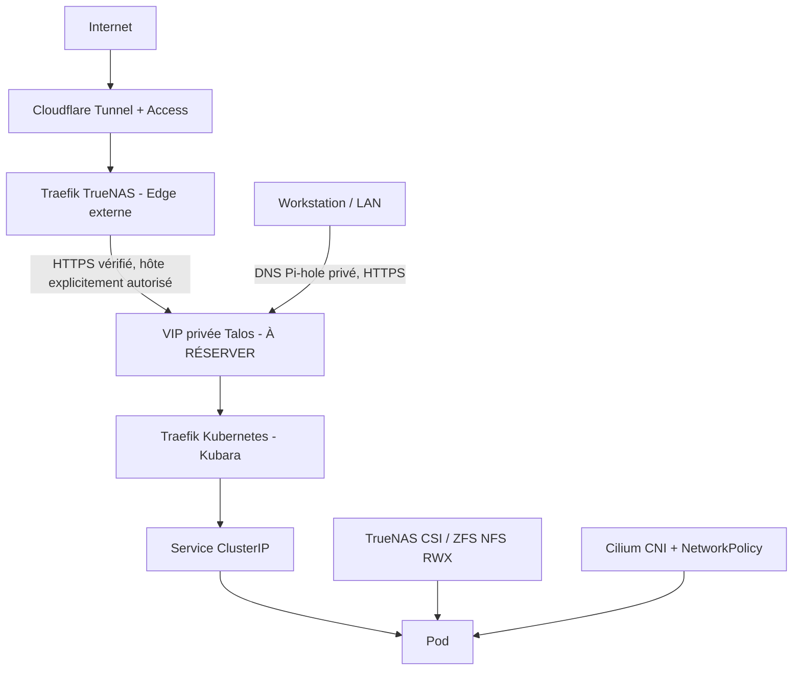

# ADR — Kubara sur Talos : deux Traefik, Cilium et stockage TrueNAS

**Date : 28 novembre 2026 · Statut : PROPOSED / CODED ; NOT_DEPLOYED.**
Sources : audit opérateur du 25/11 (voir [roadmap](../roadmap-kubernetes-security.md)),
[documentation Kubara v0.14.0](https://docs.kubara.io/v0.14.0/1_getting_started/bootstrapping/),
[Cilium LB IPAM](https://docs.cilium.io/en/stable/network/lb-ipam/),
[Cilium L2 announcements](https://docs.cilium.io/en/stable/network/l2-announcements/) et
[Longhorn sur Talos](https://longhorn.io/docs/1.13.0/advanced-resources/os-distro-specific/talos-linux-support/).

## Constat réel et objectif

Le 25/11, le cluster Talos avait trois nœuds Ready, Cilium et TrueNAS CSI
installés, Falco 3/3, **aucun Ingress ni NetworkPolicy déployé**. Kubara CLI
`0.14.0` avait été validé depuis TrueNAS dans un relevé plus ancien,
mais **aucun `config.yaml` revu ni bootstrap** n'était présent.



Deux contrôleurs Traefik sont permis **parce qu'ils sont dans des domaines
d'administration séparés** : celui de TrueNAS est un App/Docker derrière le
tunnel ; celui de Kubara est un Deployment/Service dans Talos. Il n'y a pas
de conflit IngressClass Kubernetes avec Traefik TrueNAS, qui n'observe pas
l'API Kubernetes. **Aucun port 443 n'est partagé sur la même IP** :
la future VIP Talos doit être différente de `172.17.0.24`.

La route TrueNAS→Talos n'est pas un `docker network` partagé. Elle utilise
une IP LAN/VIP routable, des certificats distincts et un backend réchiffré.
**Pas de routage direct vers les IP des Pods**.

## 1. Conserver Cilium CNI ; MetalLB n'est pas un remplacement de CNI

`kubernetes/cilium/values.yaml` contient `kubeProxyReplacement: false`,
`ipam.mode: kubernetes`. La CI et les constats du 21/11 indiquent que
Cilium applique effectivement des NetworkPolicy, mais le relevé du 25/11
n'en trouvait aucune déployée. **CNI actif ≠ segmentation effective partout**.

Kubara propose `metallb` pour annoncer les VIP et `traefik` pour HTTP ;
il ne remplace pas Cilium dans son catalogue général.

Deux options pour l'entrée bare-metal :

| Option | Avantage | Prérequis / risque |
| --- | --- | --- |
| **A. MetalLB via Kubara + Cilium CNI** | VIP L2 dédiée sans réinstaller le CNI ni modifier immédiatement kube-proxy | Réserver une IPv4 hors DHCP, vérifier ARP/R7000, désactiver tout autre allocateur VIP sur la même plage ; un seul owner des annonces |
| **B. Cilium LB IPAM + L2** | Un seul moteur Cilium pour la VIP et les politiques | **Pas une bascule simple** : la documentation Cilium exige `kubeProxyReplacement=true` pour L2 Announcements alors que le cluster est à `false`. Revue Talos/kube-proxy, sauvegarde etcd, migration CNI et rollback avant activation. `externalTrafficPolicy: Local` est incompatible avec cette fonction |

**Arbitrage provisoire : A pour la première VIP** si le cluster conserve
`kubeProxyReplacement=false`; sinon préparer B dans une PR distincte.
Le candidat Kubara garde `metallb: disabled` **tant que l'adresse et le
fonctionnement L2 ne sont pas prouvés**. Une VIP ne se devine pas.
La [préparation MetalLB L2](../runbooks/kubara-metallb-l2-pilot.md) ajoute
`scripts/talos/prepare-metallb-kubara.py` : un profil isolé est généré
avec `metallb.status=enabled` et un `loadBalancerAddressPool` privé
`/32` uniquement après validation d'une VIP réservée et acquittement
de la plage DHCP. Le manifeste CRD créé n'est qu'un contrat de revue :
l'installation reste sous la propriété Helm/Argo CD de Kubara et
aucune IP ne doit être annoncée tant que la génération réelle n'a
pas été réceptionnée.

**Compatibilité `kubeProxyReplacement: false` :** elle conserve
kube-proxy pour ClusterIP/NodePort/LoadBalancer, donc MetalLB en L2 est
compatible sans remplacement eBPF de kube-proxy. Vérifier néanmoins
le mode kube-proxy effectif (si IPVS, `strictARP=true` est impératif),
la disponibilité des speakers MetalLB, la plage DHCP R7000 et les
annonceurs concurrents. Le choix Cilium LB IPAM + annonces L2 serait
un chantier séparé exigeant `kubeProxyReplacement: true`, la mise en
place d'un hôte/port API Kubernetes explicite pour Cilium, l'enforcement
des NetworkPolicy après bascule, un test NodePort/LB et un rollback
etcd/Talos. Ne pas activer deux annonceurs L2 sur la même VIP.

## 2. TrueNAS CSI ne se remplace pas automatiquement par Longhorn

Le pilote réellement sélectionné est **`truenas/truenas-csi`** (et non
`democratic-csi`) : `csi.truenas.io`, StorageClass
`nabla-truenas-nfs`, provisionnement de datasets sous `cpool/k8s/csi`,
partages NFS v4.1 via l'API TrueNAS, accès RWX, reclaim `Delete`.
Ces intégrations **ne sont pas fournies par Kubara**.

Kubara propose **Longhorn** (stockage bloc distribué/RWO) et **Velero**
(sauvegarde/restauration), pas un driver TrueNAS API identique. Longhorn
sur Talos exige notamment `siderolabs/iscsi-tools`,
`siderolabs/util-linux-tools`, les montages/volumes Talos adaptés,
un namespace `privileged` et des ressources CPU/RAM/disque supplémentaires.
Les workers 2 Gio documentés sur ce homelab rendent le sizing indispensable.

**Décision :** préserver la StorageClass TrueNAS CSI et les données déjà
provisionnées. Étudier une StorageClass Longhorn RWO **complémentaire**
seulement avec une sauvegarde testée, une image Talos compatible, un test
de restauration et une migration *PVC par PVC*. Ne jamais modifier la
StorageClass existante en place ni déplacer un PVC RWX vers RWO.

## 3. Coupler les deux Traefik par HTTPS de bout en bout

- **Edge TrueNAS** : point d'entrée de Cloudflare Tunnel, Access et CrowdSec,
  allowlist explicite de hostnames ; aucun wildcard Talos relayé sans revue.
  Le tunnel Cloudflare ne doit pas voir directement la VIP Talos.
- **Traefik Kubara** : IngressClass `traefik` au sein du cluster, d'abord
  interne. Un seul contrôleur associé à cette classe ; pas de seconde
  installation manuelle du chart Traefik.
- **Exemple versionné, volontairement non monté** :
  [`apps/traefik/examples/talos-kubara-bridge.example.yml`](../../apps/traefik/examples/talos-kubara-bridge.example.yml).
  Il n'est **pas chargé** par `--providers.file.directory=/etc/traefik-dynamic`.
  La route `test.int.albandrieu.com` refuse les pairs non LAN et utilise
  `serversTransport` avec vérification TLS explicite, SNI et CA privée.
  Remplacer les **deux placeholders** (VIP et chemin CA) uniquement après
  réception du service Kubara et du certificat.
- **TLS par défaut sécurisé dans la PR #456** : la configuration
  TrueNAS `apps/traefik/compose.yml` passe de
  `--serversTransport.insecureSkipVerify=true` à
  `--serversTransport.insecureSkipVerify=false`. Le pont conserve
  `insecureSkipVerify: false` et un `serverName` explicite.
  **CODED ≠ DEPLOYED** : avant le redéploiement Traefik, contrôler
  les backends HTTPS réels. Le commentaire historique Proxmox signalait
  une CA autosignée et un possible HTTP 500/502 ; si un backend actif
  utilise une CA privée, ajouter une `serversTransport` locale avec
  `rootCAs` et SNI, sans rouvrir le bypass global.
  Le wildcard Let's Encrypt **entrant** de TrueNAS ne suffit pas à
  valider le certificat **sortant** de Traefik Kubernetes : ce dernier
  doit disposer de son propre certificat et de son renouvellement.
- **Identité / IP client** : seule l'IP de socket de cloudflared est
  autorisée à fournir les en-têtes externes côté TrueNAS. L'instance
  Kubernetes ne doit faire confiance à `X-Forwarded-For` **que depuis
  l'IP source effective de Traefik TrueNAS**, après vérification NAT ;
  refuser tout en-tête inventé par un client LAN.
- **DNS** : Pi-hole résout le futur hostname direct sur la VIP interne,
  Cloudflare conserve le domaine public sur l'edge TrueNAS. Aucune
  publication WAN directe de la VIP ni de `/dashboard` Argo CD.

## 4. Configuration et étapes de réception

Fichiers préparés :

- `config/kubara/config.candidate.yaml` : candidat de profil Kubara
  **v0.14.0**, avec Traefik activé et MetalLB/Longhorn/ExternalDNS/
  ExternalSecrets/CertManager et composants lourds **désactivés**.
  Il n'est **pas nommé `config.yaml`** : le bootstrap reste bloqué.
  Les versions OCI `bootstrap:2.0.0` et `general:2.0.0` proviennent
  de la documentation Kubara **v0.14.0** ; elles sont **candidates** jusqu'à
  validation contre le schéma de la CLI et les signatures/catalogues réels.
- `scripts/talos/prepare-metallb-kubara.py` : essai MetalLB L2 opt-in,
  génération isolée du profil Kubara et de la CRD de référence, **aucun apply**.
  Voir [les gates M0-M5](../runbooks/kubara-metallb-l2-pilot.md).
- `scripts/talos/audit-kubara-integration.py` : audit statique offline,
  puis constat Kubernetes optionnel **read-only, avec acquittement explicite**.
- `tests/test_kubara_integration_contract.py` : refus des dérives Cilium,
  StorageClass TrueNAS, services non prévus, TLS désactivé et des appels
  d'observation de cluster non autorisés.

Depuis le clone `nabla-compose` sur TrueNAS ou une workstation ayant les outils :

```bash
python3 scripts/talos/audit-kubara-integration.py
python3 -m unittest tests.test_kubara_integration_contract -v

# Réception runtime - AUCUN apply :
python3 scripts/talos/audit-kubara-integration.py \
  --cluster-readonly --ack-cluster-readonly
bash scripts/talos/preflight-kubara.sh --pre-bootstrap

# Génération Kubara en espace jetable : vérifier CLI version et schéma.
# Aucun fichier config.yaml n'est promu sur master.
WORKDIR="$(mktemp -d)"
git init -q "$WORKDIR"
cp config/kubara/config.candidate.yaml "$WORKDIR/config.yaml"
(
  cd "$WORKDIR"
  KUBARA_UPDATE_CHECK=0 kubara schema --output config.schema.json
  KUBARA_UPDATE_CHECK=0 kubara generate --helm --dry-run
)
# Supprimer le workdir uniquement après avoir revu la sortie ;
# ne jamais y copier un .env réel non chiffré.
```

**Gates qui restent non exécutées** :
1. Schéma Kubara **v0.14.0** et génération Helm réels ; vérifier services
   rendus, les valeurs Traefik, secrets/CRD et l'absence d'une nouvelle
   publication WAN, de MetalLB/Longhorn/Kyverno/Prometheus non voulus.
2. Inventaire de l'IP source, DHCP R7000, réservation de VIP et mécanisme
   d'annonce L2 ; un essai LAN négatif et un essai WAN indépendant.
3. Certificat pour `test.int.albandrieu.com`, chaîne CA montée en
   lecture seule dans Traefik TrueNAS, TLS `verify-full` avec SNI et
   réponse de bout en bout.
4. Approbation du `config.yaml` final, secrets dans un magasin dédié,
   puis `KUBARA_ALLOW_BOOTSTRAP=1` **uniquement** dans le runbook
   de mise en service supervisée. Smoke FastAPI par image/digest immuable.
5. Contrôles de rollback : Argo CD et ingress supprimés **sans toucher
   Cilium, CSI, NFS, Cloudflare Tunnel ou Traefik TrueNAS**.

Aucun de ces points n'est déclaré `DEPLOYED` par les fichiers Git.
