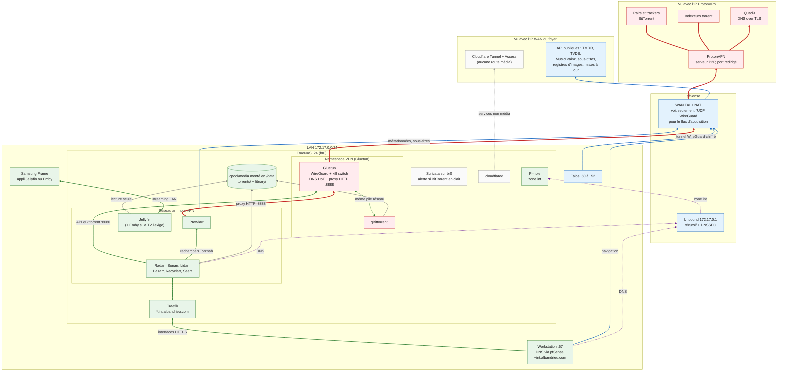

# Bibliothèque média \*arr — roadmap d'installation et d'anonymisation

> Mise à jour : **8 novembre 2026** (décisions de l'opérateur, recherches
> complémentaires et implémentation `CODED`, non déployée, au §10). Document d'architecture **canonique** pour la
> pile \*arr (acquisition, organisation, consommation), la frontière VPN des
> téléchargements et la stratégie DNS associée. Il remplace les sections
> ARR/VPN/stockage de [`arr-security-integration-roadmap.md`](arr-security-integration-roadmap.md),
> qui ne conserve que CrowdSec/Traefik, Dozzle et les MCP sécurité. Les priorités
> courantes restent indexées dans [`roadmap.md`](roadmap.md).
>
> Ce document **n'autorise aucune mutation**. Chaque phase exige une sauvegarde,
> un plan en lecture seule, l'accord de l'opérateur et une preuve de retour
> arrière (voir les règles de `roadmap.md`).

## 1. Synthèse des recommandations

1. **VPN par namespace, pas par hôte ni par pfSense.** Un conteneur Gluetun
   (WireGuard) partage sa pile réseau avec **qBittorrent seulement**
   (`network_mode: service:gluetun`). Le pare-feu de Gluetun assure le kill
   switch. Les autres services TrueNAS et le LAN ne sont pas touchés.
2. **DNS over TLS émis dans le tunnel.** Le résolveur intégré de Gluetun
   (DoT vers Quad9) ne sort que par l'interface VPN. Ni pfSense, ni Pi-hole, ni
   les résolveurs de secours de TrueNAS ne voient les requêtes du client torrent.
   Pas de forwarder DNS supplémentaire sur TrueNAS.
3. **Indexeurs via le proxy HTTP de Gluetun.** Prowlarr reste sur le réseau
   Docker normal et passe toutes ses requêtes externes par le proxy HTTP
   authentifié de Gluetun. Si le VPN tombe, les recherches échouent
   (fail-closed) au lieu de partir par le WAN.
4. **Le reste hors VPN.** Radarr, Sonarr, Bazarr, Seerr, le serveur média,
   Traefik, Pi-hole et les autres services gardent la sortie WAN et le DNS
   pfSense/Unbound actuels ([contrat DNS](dns-ingress-ownership.md)).
5. **Aucune interface \*arr publique.** Supprimer d'abord les sept noms publics
   hérités (§2.3). L'accès passe uniquement par le LAN, via Traefik
   `*.int.albandrieu.com` ; pas d'accès distant pour l'instant (D5).

### Décisions de l'opérateur (7 novembre 2026)

| # | Sujet | Décision | Conséquence |
| --- | --- | --- | --- |
| D1 | Fournisseur VPN | **ProtonVPN**, abonnement à souscrire (offre avec serveurs P2P et port forwarding) | P2 ne démarre qu'après la souscription et la génération d'une configuration WireGuard avec NAT-PMP |
| D2 | Serveur média | **Jellyfin** comme cible ; **Emby** conservé seulement si la Samsung Frame ne peut pas utiliser Jellyfin | test de la TV en P0 (§8) |
| D3 | Stockage | aucun pool ni bibliothèque existants | dataset `cpool/media` avec quota, selon l'espace libre mesuré ; pool dédié plus tard si la bibliothèque grandit |
| D4 | Usenet | explication demandée | différé, voir §12 ; SABnzbd non installé |
| D5 | Accès distant | **aucun** pour l'instant | suppression des sept noms publics, y compris `emby` ; Seerr reste LAN |
| D6 | DoT pour tout le LAN | non décidé | hors périmètre (§5.4) |
| — | Apps \*arr natives | **PoC jamais finalisés** : suppression validée (Transmission et Readarr en premier) | pas de sauvegarde ni de migration ; réinstallation à neuf via `apps/` |
| — | Plex et Whisparr | **suppression confirmée** le 8 novembre (PoC) | même procédure que les autres PoC (§8, P0 item 3) |

## 2. État existant

Niveaux de preuve : `CODED` (dépôt), `OBSERVED` (mesure datée), `NOT_VERIFIED`.

### 2.1 Source Servers@Home analysée

Pages lues le 7 novembre 2026 : [Arr Stack](https://wiki.serversatho.me/en/arr-stack),
[Install Instructions](https://wiki.serversatho.me/InstallInstructions),
[Folder Structure](https://wiki.serversatho.me/Folder-Structure),
[Overview Map](https://wiki.serversatho.me/OverviewMap) et
[qBittorrent](https://wiki.serversatho.me/qBittorrent).

**À reprendre :**

- l'ordre d'installation : stockage, VPN, client torrent, Radarr/Sonarr,
  Prowlarr, profils de qualité, serveur média, Seerr, Bazarr ;
- un **seul dataset** `media` avec des sous-répertoires (pas de sous-datasets),
  pour que les hardlinks et les déplacements atomiques fonctionnent ;
- un client torrent lié à l'interface VPN, avec DNS dans le tunnel ;
- libtorrent 2.x et le type d'E/S disque « POSIX-compliant » sur ZFS.

**À ne pas reprendre :**

- le script `arr-complete.sh`, exécuté en root via `wget … && bash`. Il crée et
  démarre des stacks implicitement, utilise des images `latest` et ajoute
  Dockge et Watchtower, en concurrence avec `apps/`, Renovate et
  [`apps/watchtower`](watchtower-service-units.md) ;
- les permissions `root:apps 770` et le compte commun `admin`/`changeme`
  partagé par toutes les applications ;
- la variante WireGuard générique : la protection anti-fuite y dépend d'une
  ligne `PostUp` iptables recopiée à la main. Elle ajoute aussi des routes LAN
  larges (`10/8`, `172.16/12`, `192.168/16`, `100.64/10`) ;
- le conseil de remplacer le DNS du fournisseur par `1.1.1.1` en clair. Le DoT
  dans le tunnel est préférable (§5) ;
- le catalogue d'environ 45 outils de la page d'index : c'est un outil de
  découverte, pas une liste d'installation.

### 2.2 nabla-compose (`CODED`, état du 7 novembre avant l'implémentation du §10)

- **Aucun** `apps/<service>/compose.yml` pour une application \*arr, un client
  torrent, Gluetun ou un serveur média.
- Les briques réutilisables existent : `apps/traefik`, `apps/pihole`
  (avec `pihole-dns-sync`), `apps/dozzle`, `apps/watchtower`, `apps/crowdsec`,
  `apps/gatus`, `apps/homarr`, et `apps/suricata` en `network_mode: host` sur
  `br0` (utile comme détecteur de fuite, §8 P6).
- [`truenas-file-structure.sh`](../truenas-file-structure.sh) est un ancien
  générateur dérivé de Servers@Home. Il est à **geler** :
  - images `latest` ;
  - `VPN_PROVIDER=generic` combiné à `VPN_AUTO_PORT_FORWARD=true` : l'image
    hotio ne gère le port automatique qu'avec `proton` ou `pia` ;
  - `VPN_FIREWALL_TYPE` a été retiré de l'image ;
  - Prowlarr n'a ni `PUID` ni `PGID` ;
  - `toparr` tourne avec `pid: host`, `SYS_ADMIN` et `SYS_PTRACE`.
- `catalog/homelab-services.json` déclare lidarr, prowlarr, radarr, sabnzbd,
  sonarr et transmission avec `external: false`, **mais** chacun avec un
  `tunnelUrl` `https://<id>.albandrieu.com`.
- `terraform/cloudflare/tunnel.tofu` route `emby.albandrieu.com` vers
  `172.17.0.24:8096`. C'est la seule route média codée.
- `config/truenas/restore-optional-apps.txt` liste les Apps TrueNAS natives
  `bazarr`, `cleanuparr`, `emby`, `lidarr`, `plex`, `prowlarr`, `radarr`,
  `readarr`, `sonarr`, `tracearr`, `transmission`, `whisparr`, `wizarr`, ainsi
  que `arti`, `i2p`, `tailscale`, `squid` et `three-proxy`.
- [`roadmap.md`](roadmap.md) garde un diagnostic P0 ouvert sur `lidarr`.

### 2.3 Exposition publique observée (`OBSERVED`, 7 novembre 2026)

Mesure faite depuis un client externe situé hors de France : DNS via DoH, puis
`HEAD /` en HTTPS.

| Noms `*.albandrieu.com` | DNS public | Réponse HTTPS |
| --- | --- | --- |
| `radarr`, `sonarr`, `prowlarr`, `lidarr`, `transmission`, `sabnzbd`, `emby` | A proxifiés Cloudflare. Ce sont des enregistrements explicites : un nom aléatoire ne résout pas. | `403` texte servi par Cloudflare, **sans** redirection Cloudflare Access |
| `gatus` (témoin) | A proxifiés Cloudflare | `302` vers Cloudflare Access |

**Interprétation (risque potentiel) :** sept noms média sont publiés. Le `403`
ressemble à une règle WAF (pays, IP ou bot), pas à une politique Access. Il est
donc possible qu'un client situé en France atteigne l'origine. Ce point est
`NOT_VERIFIED` depuis la France et doit être traité en P0 (§8).

### 2.4 TrueNAS (`NOT_VERIFIED`)

L'état runtime des Apps natives n'a pas été relu pour ce document (pas d'accès
LAN). Dernières observations documentées :

- Lidarr est en diagnostic P0 ;
- Transmission et Emby étaient arrêtés lors de la revue du 13 septembre ;
- le dataset `cpool/sabnzbd` est vide (candidat de revue).

**Confirmation de l'opérateur (7 novembre) :** ces Apps \*arr sont des PoC
jamais finalisés. Il n'existe ni bibliothèque ni pool média. Elles sont
supprimées, pas migrées, et le diagnostic P0 de Lidarr devient sans objet.

Seul le pool `cpool` est documenté. Un commentaire de
`scripts/truenas/diagnose-performance.sh` évoque un pool raidz2 ; sa
topologie et son espace libre sont `NOT_VERIFIED` (D3).

## 3. Matrice des services

| Service | Rôle | Servers@Home | Nabla aujourd'hui | Décision | Phase |
| --- | --- | --- | --- | --- | --- |
| Gluetun | passerelle VPN WireGuard, DNS DoT, proxy HTTP | variante | analyse seulement | **Ajouter** | P2 |
| qBittorrent | client BitTorrent | oui (hotio + WireGuard) | script legacy | **Ajouter**, dans le namespace Gluetun | P2 |
| Transmission | client BitTorrent | non | App native (PoC) et DNS public | **Supprimer** (validé : doublon, hors VPN) | P0 |
| SABnzbd | client Usenet | oui | catalogue, DNS public, dataset vide | **Différer** (D4, §12) ; supprimer le nom public | — |
| Prowlarr | gestion des indexeurs | oui | App native (PoC) | **Supprimer le PoC, réinstaller à neuf**, derrière le proxy Gluetun | P0 / P3 |
| FlareSolverr / Trawl / Byparr | contournement Cloudflare des indexeurs | oui (Trawl) | script legacy | **Seulement si un indexeur l'exige** (§6.3) | P3 |
| Radarr | films | oui | App native (PoC) | **Supprimer le PoC, réinstaller à neuf** | P0 / P4 |
| Sonarr | séries | oui | App native (PoC) | **Supprimer le PoC, réinstaller à neuf** | P0 / P4 |
| Lidarr | musique | hors cœur | App native (PoC) | **Supprimer le PoC** ; réinstaller après Radarr et Sonarr | P0 / P4 |
| Readarr | livres | remplacé par Chaptarr | App native (PoC) | **Supprimer** (validé ; projet arrêté par ses mainteneurs). Chaptarr, encore en bêta : plus tard | P0 |
| Whisparr | — | non | App native (PoC) | **Supprimer** (PoC \*arr, confirmé le 8 novembre) | P0 |
| Recyclarr / Profilarr | profils de qualité TRaSH | Profilarr | Profilarr (legacy), Recyclarr (roadmap de septembre) | **Recyclarr** : configuration YAML versionnée et revue en PR | P4 |
| Bazarr | sous-titres | oui | App native (PoC) | **Supprimer le PoC, réinstaller à neuf** | P0 / P5 |
| Jellyfin / Emby / Plex | serveur média | Emby / Jellyfin | Emby et Plex natifs, Jellyfin legacy | **Jellyfin** (D2). Emby en Compose, LAN seulement, si la Frame l'exige. Plex : suppression confirmée | P0 / P5 |
| Seerr | demandes | oui | script legacy | **Ajouter** après D2 | P5 |
| Unpackerr | extraction des `.rar` | oui | — | seulement si des releases archivées sont observées | P6 |
| Cleanuparr | torrents bloqués, faux ou malveillants | — | App native (PoC) | supprimer le PoC ; réinstaller après stabilisation de qBittorrent | P0 / P6 |
| Wizarr, Tracearr | invitations, statistiques de lecture | oui | Apps natives (PoC) | supprimer les PoC ; seulement en cas de partage avec d'autres utilisateurs | P0 / P6 |
| Tdarr | transcodage | oui | — | après mesure CPU, GPU et E/S | P6 |
| Exportarr / Scraparr | métriques Prometheus | — | roadmap de septembre | **un seul des deux** | P6 |
| Dockge, Watchtower de Servers@Home | gestion des stacks, mises à jour | oui | `apps/`, Renovate, `apps/watchtower` | **Ne pas ajouter** | — |
| arti, i2p (Tor) | anonymat | — | Apps natives | **Ne jamais** y faire passer BitTorrent : fuites d'IP par le protocole, charge imposée au réseau Tor | — |

## 4. Architecture cible

```text
                               Internet
                                  ▲
                 WireGuard (UDP)  │  seul flux d'acquisition visible par
                                  │  le FAI et par pfSense
┌──────────────────────── TrueNAS 172.17.0.24 (br0) ─────────────────────────┐
│                                                                             │
│  namespace « acquisition » (projet Compose apps/media-acquisition)          │
│  ┌──────────────────────────────────────────────────┐                       │
│  │ gluetun     interface VPN + kill switch          │◄─ proxy HTTP :8888 ───┼─ prowlarr
│  │             DNS 127.0.0.1 → DoT Quad9 via VPN    │   (réseau arr)        │  (+ flaresolverr si requis)
│  │ qbittorrent WebUI :8080, liée à l'interface VPN  │◄─ API :8080 ──────────┼─ radarr / sonarr / lidarr
│  └──────────────────────────────────────────────────┘                       │
│                                                                             │
│  réseau Docker « arr », hors VPN : prowlarr, radarr, sonarr, lidarr,        │
│  bazarr, recyclarr, seerr, serveur média                                    │
│      DNS : Docker → TrueNAS → pfSense Unbound (inchangé)                    │
│                                                                             │
│  /mnt/cpool/media ── monté en /data ── qbittorrent, *arr, serveur média (ro)│
└─────────────────────────────────────────────────────────────────────────────┘
      Traefik *.int.albandrieu.com (LAN) ─► interfaces ; aucune route *arr publique
```

Règles d'architecture :

- Seuls `gluetun` et `qbittorrent` partagent le namespace. Le §6.3 explique
  pourquoi Prowlarr et FlareSolverr n'y entrent pas par défaut.
- `network_mode: service:` ne fonctionne qu'à l'intérieur d'un même projet
  Compose. Gluetun et qBittorrent forment donc **une** unité de déploiement :
  `apps/media-acquisition/`. Les autres services suivent `apps/<service>/`,
  avec métadonnées `x-nabla` et relations selon
  [`nabla-service-catalog`](../.agents/skills/nabla-service-catalog/SKILL.md).
- Si Gluetun redémarre seul, qBittorrent perd sa pile réseau. Il faut donc
  `depends_on: {gluetun: {condition: service_healthy, restart: true}}`, et
  Renovate comme Watchtower doivent mettre à jour l'unité entière, jamais
  Gluetun isolément.

### 4.1 Vue réseau complète : qu'est-ce qui passe dans le VPN ?

Le tunnel ProtonVPN part du namespace Gluetun sur TrueNAS. pfSense **n'est
pas** client VPN : pour ce flux, il ne route que de l'UDP WireGuard chiffré.
La workstation, Talos et le reste du LAN sortent normalement avec l'IP WAN.

Légende : rouge = tunnel ProtonVPN ; bleu = sortie directe avec l'IP WAN ;
vert = LAN uniquement ; violet = DNS du LAN ; gris = stockage et Cloudflare.



| Flux | Dans ProtonVPN ? | Raison |
| --- | --- | --- |
| qBittorrent : pairs, trackers, DHT | **Oui**, obligatoire | c'est le flux qui expose l'IP aux autres pairs et aux sociétés de surveillance |
| DNS de qBittorrent et du proxy (DoT Quad9) | **Oui** | ni le FAI ni Quad9 ne voient l'IP du foyer |
| Prowlarr vers les indexeurs (recherche, fichiers `.torrent`) | **Oui**, via le proxy :8888 | les recherches révèlent les titres recherchés |
| FlareSolverr (si nécessaire) | **Oui**, selon §6.3 | il visite les mêmes indexeurs |
| Radarr, Sonarr, Lidarr vers TMDB, TVDB, MusicBrainz, Servarr | Non (option N3) | métadonnées publiques ; les API limitent souvent les IP VPN |
| Bazarr vers les fournisseurs de sous-titres | Non (option N3) | même raison |
| Échanges \*arr ↔ qBittorrent ↔ Prowlarr | Non, réseau Docker local | ne sortent pas de TrueNAS |
| Jellyfin ou Emby vers la Samsung Frame | Non, LAN | le streaming local ne doit pas dépendre du VPN |
| Métadonnées Jellyfin/Emby, licence Emby | Non | services publics, sans lien avec le téléchargement |
| Cloudflare Tunnel (`cloudflared`) | Non | le VPN casserait les services publiés |
| Images Docker, Renovate, mises à jour TrueNAS, pfSense et Talos | Non | pas de lien avec le téléchargement |
| Navigation de la workstation | Non par défaut | voir ci-dessous |
| Télémétrie de la TV Samsung | Non | à limiter plutôt par pfBlockerNG ou un VLAN IoT (optionnel) |

**Workstation (optionnel, hors périmètre).** Un abonnement Proton couvre
plusieurs appareils, donc la workstation peut avoir son propre client
ProtonVPN pour la navigation personnelle. Ce client doit alors exclure le LAN
`172.17.0.0/24` et préserver le routage DNS `~int.albandrieu.com` vers pfSense
([split DNS de la workstation](https://github.com/AlbanAndrieu/ansible-workstation/blob/master/docs/homelab-split-dns-architecture.md)).
Sinon, les interfaces `*.int.albandrieu.com` cessent de résoudre. Aucun lien
avec la pile \*arr : à traiter, si besoin, dans `ansible-workstation`.

## 5. Stratégie DNS

### 5.1 Trois zones, trois chemins

| Zone | Clients | Résolveur | Transport | Qui voit les requêtes |
| --- | --- | --- | --- | --- |
| Acquisition | qBittorrent (trackers, DHT), proxy HTTP Gluetun (requêtes de Prowlarr) | DNS intégré de Gluetun | DoT vers Quad9, **dans** le tunnel | Quad9, qui ne voit que l'IP de sortie VPN. Ni le FAI, ni pfSense, ni Pi-hole. |
| Homelab | Radarr, Sonarr, Bazarr, Seerr, serveur média, autres conteneurs, TrueNAS | DNS Docker, puis pfSense Unbound `172.17.0.1` ; `int.albandrieu.com` vers Pi-hole | récursif depuis le WAN (inchangé) | Serveurs autoritatifs et FAI : noms de domaine des API de métadonnées. Les titres restent dans HTTPS. |
| Clients LAN | postes, nœuds Talos… | pfSense Unbound | inchangé | inchangé |

### 5.2 Pourquoi pas un forwarder DNS sur TrueNAS ou pfSense

- **Le DoT seul n'anonymise pas.** Il chiffre la requête vis-à-vis du FAI, mais
  le résolveur public voit toujours l'IP WAN du foyer. Le DoT **émis depuis le
  tunnel** masque les deux. Le namespace Gluetun l'obtient sans composant
  supplémentaire.
- **Un forwarder sur TrueNAS** (Unbound ou AdGuard en conteneur) ajouterait un
  saut en clair entre conteneurs et un point de panne partagé. Si son amont ne
  sort pas par le VPN, il révèle l'IP WAN au résolveur. Il recréerait aussi la
  dépendance circulaire TrueNAS ↔ DNS hébergé sur TrueNAS, déjà proscrite.
- **Passer pfSense Unbound en forwarding DoT** changerait le contrat validé
  (`Forwarding Mode: disabled`) pour tout le LAN. Cela n'améliore pas
  l'anonymat des téléchargements, qui ne passent pas par Unbound. Unbound sur
  pfSense a déjà eu des incidents mémoire
  ([diagnostic](../scripts/pfsense/diagnose-unbound-crash-memory.sh)) : ne pas
  le placer dans le chemin critique d'un nouveau service.
- **Split DNS.** Le seul découpage nécessaire existe déjà
  (`int.albandrieu.com` → Pi-hole). Le namespace d'acquisition n'a besoin
  d'aucun nom privé, donc d'aucune exception DNS vers le LAN. C'est une autre
  raison de laisser Prowlarr hors du namespace : il devrait sinon résoudre les
  noms Docker ou LAN de Radarr et Sonarr.

### 5.3 Réglages DNS de Gluetun

Référence : [options DNS de Gluetun](https://github.com/qdm12/gluetun-wiki/blob/main/setup/options/dns.md).
À revérifier sur la version épinglée.

- `DNS_UPSTREAM_RESOLVER_TYPE=dot` et `DNS_UPSTREAM_RESOLVERS=quad9` (défaut :
  `cloudflare`) ;
- `DNS_UPSTREAM_IPV6=off` et `BLOCK_MALICIOUS=on` ;
- **ne jamais définir** `DNS_UPSTREAM_PLAIN_ADDRESSES` vers Pi-hole, pfSense
  ou une IP de bridge. La documentation de Gluetun prévient que le DNS peut
  alors sortir du tunnel ;
- alternative acceptable : le DNS du fournisseur VPN dans le tunnel, si ce
  fournisseur le recommande. Cela évite un tiers supplémentaire.

### 5.4 Option LAN séparée (D6, non requise ici)

Si l'objectif devient de cacher au FAI le DNS de **tout** le LAN : passer
pfSense Unbound en Forwarding Mode, activer « Use SSL/TLS for outgoing DNS
Queries to Forwarding Servers » vers `dns.quad9.net:853`, et conserver la
Domain Override `int.albandrieu.com` ainsi que la validation DNSSEC.

Le compromis : la visibilité du FAI est remplacée par la confiance en Quad9. À
instruire séparément avec le
[skill pfSense](../.agents/skills/pfsense-api-debugging/SKILL.md).

Les résolveurs de secours en clair de TrueNAS (`9.9.9.9`, `1.1.1.1`) restent en
place : ils font partie du contrat de reprise et ne concernent pas la zone
acquisition.

## 6. Stratégie VPN

### 6.1 Options comparées

| Option | Isolation | Effet sur les autres services | Kill switch | Complexité | Verdict |
| --- | --- | --- | --- | --- | --- |
| A. Gluetun + `network_mode: service:gluetun` sur TrueNAS | namespace réseau du conteneur | aucun | pare-feu Gluetun : tout est bloqué hors tunnel, y compris avant sa montée | faible, pattern standard | **Recommandée** |
| B. WireGuard intégré à l'image qBittorrent (hotio) | même isolation, pour qBittorrent seul | aucun | nftables de l'image | faible | acceptable pour un seul conteneur, mais pas de proxy pour Prowlarr |
| C. Client WireGuard sur pfSense + routage par politique (VLAN dédié ou IP alias TrueNAS) | segment réseau | modifie le routeur de tout le foyer | règles PF et passerelle par défaut bloquée | élevée : VLAN ou macvlan sur TrueNAS, vues Unbound | **Non retenue** : touche l'équipement critique pour un bénéfice local |
| D. Tor (`arti`, `i2p`) | — | — | — | — | **Exclue** pour BitTorrent |
| E. VPN sur tout l'hôte TrueNAS | — | casse Cloudflare Tunnel, l'accès LAN et les mises à jour | — | — | **Exclue** |

### 6.2 Fournisseur (décision D1)

Critères : WireGuard, port forwarding (nécessaire pour être joignable et
partager), politique no-log vérifiable, prise en charge native par Gluetun
([port forwarding Gluetun](https://github.com/qdm12/gluetun-wiki/blob/main/setup/advanced/vpn-port-forwarding.md)).

| Fournisseur | Port forwarding | Intégration Gluetun | Remarque |
| --- | --- | --- | --- |
| ProtonVPN Plus | dynamique (NAT-PMP), sur les serveurs P2P | native : `VPN_PORT_FORWARDING=on`, `PORT_FORWARD_ONLY=on` | déjà évalué en septembre ; le port change, il faut le synchroniser dans qBittorrent (§6.3) |
| AirVPN | statique, attribué dans l'espace client | fournisseur pris en charge, port ouvert par `FIREWALL_VPN_INPUT_PORTS` | choix de Servers@Home ; un port fixe supprime l'appel d'API vers qBittorrent |
| Mullvad | supprimé en 2023 | native | bon anonymat de paiement, mais client non joignable : partages de mauvaise qualité |
| Private Internet Access | dynamique | native | juridiction des États-Unis |

**Décision D1 (7 novembre) : ProtonVPN.** Cohérent avec l'analyse de
septembre et doté d'audits no-log publiés. AirVPN reste l'alternative si l'on
veut un port statique sans synchronisation (§6.3).

Prérequis relevés dans la documentation Proton et Gluetun (§13) :

- une offre payante avec serveurs P2P (icône double flèche) ; le prix et le
  nombre d'appareils sont à lire sur la page officielle au moment de la
  souscription (les sources secondaires se contredisent) ;
- une configuration WireGuard générée avec l'option **NAT-PMP (port
  forwarding)** ; elle est incompatible avec le « NAT modéré » ;
- dans Gluetun : `VPN_SERVICE_PROVIDER=protonvpn`, `PORT_FORWARD_ONLY=on`,
  `VPN_PORT_FORWARDING=on`. Ne fixer le port ni dans qBittorrent ni dans les
  `ports` de Gluetun : c'est la commande UP qui le règle ;
- UPnP et NAT-PMP désactivés dans qBittorrent ;
- moyen de paiement non nominatif si l'anonymat vis-à-vis du fournisseur
  compte (à vérifier à la souscription).

### 6.3 Synchronisation du port et accès localhost

Avec Proton, Gluetun exécute `VPN_PORT_FORWARDING_UP_COMMAND`. Cette commande
appelle l'API de qBittorrent sur `127.0.0.1:8080`, ce qui exige l'option
« Bypass authentication for clients on localhost ». Le modèle de commande
renseigne aussi l'interface VPN (`{{VPN_INTERFACE}}`) dans qBittorrent.

**Conséquence :** tout processus du namespace pilote qBittorrent sans mot de
passe, y compris l'option « exécuter un programme externe ». Cela revient à
exécuter des commandes avec un accès en écriture à `/data`. D'où les règles
suivantes :

- seuls `gluetun` et `qbittorrent` vivent dans le namespace ;
- FlareSolverr, un Chromium sans interface qui charge des pages d'indexeurs non
  fiables, n'entre **jamais** dans ce namespace tant que le bypass localhost est
  actif. S'il devient nécessaire derrière le VPN, choisir l'une de ces options :
  - port statique (AirVPN) et bypass désactivé ;
  - synchronisation par un conteneur auxiliaire authentifié ;
  - second namespace Gluetun dédié à l'indexation ;
- `VPN_PORT_FORWARDING_DOWN_COMMAND` remet le port à 0. C'est le contournement
  documenté par Gluetun pour un bogue de qBittorrent.

### 6.4 Comportement fail-closed attendu

- Tunnel absent : qBittorrent n'a aucune sortie, le pare-feu Gluetun bloque
  tout.
- Gluetun arrêté : le namespace disparaît, qBittorrent n'a plus de réseau et ne
  redémarre qu'avec un Gluetun sain.
- Proxy `:8888` indisponible : Prowlarr est en erreur, sans repli direct.
- IPv6 désactivé dans le namespace. Si le WAN ou le LAN fournit de l'IPv6, une
  fuite IPv6 est le premier scénario à tester (§9).

## 7. Stockage et permissions

Un dataset unique garantit les hardlinks et les déplacements atomiques. Les
noms suivent [TRaSH Guides](https://trash-guides.info/File-and-Folder-Structure/)
(`/data/torrents`, `/data/media`), avec `library` à la place de `media` pour
éviter `/mnt/cpool/media/media`.

```text
/mnt/cpool/media            dataset preset APPS (ou pool HDD : décision D3), apps:apps (568:568)
├── torrents/               écrit par qBittorrent
│   ├── incomplete/
│   └── movies/  tv/  music/        catégories qBittorrent
└── library/                écrit par Radarr, Sonarr, Lidarr et Bazarr ; lu par le serveur média
    └── movies/  tv/  music/
```

- **Montages :** le même `/mnt/cpool/media:/data` dans qBittorrent, Radarr,
  Sonarr, Lidarr et Bazarr. Le serveur média monte
  `/mnt/cpool/media/library:/data/library:ro`.
- **Configuration et secrets :** les configurations vont dans
  `/mnt/cpool/<service>` (preset APPS) et les secrets dans
  `/mnt/cpool/secrets/runtime/<service>/`
  ([disposition runtime](truenas-runtime-layout.md)).
- **ZFS :** `recordsize=1M`, `compression=lz4`, `atime=off`. Côté qBittorrent :
  libtorrent 2.x et le type d'E/S disque « POSIX-compliant ». À valider par une
  mesure ARC et mémoire (P1 performance de `roadmap.md`).
- **Snapshots :** la bibliothèque peut être retéléchargée et les torrents
  changent sans cesse. Pas de tâche fréquente sur `cpool/media`, pour éviter la
  croissance déjà constatée ([politique snapshots](truenas-zfs-snapshot-policy.md)).
  Les configurations `cpool/<arr>` rejoignent la tâche « Small configuration »,
  en plus des sauvegardes intégrées aux applications \*arr.
- **Permissions :** `PUID=568`, `PGID=568`, `UMASK=002`, ACL preset APPS. Pas de
  `root:apps 770`. L'image Seerr tourne avec l'UID 1000 : à vérifier sur la
  version épinglée.
- **Test hardlink obligatoire :** `stat -c '%h %i'` sur le fichier dans
  `torrents/` et dans `library/` doit donner le même inode et 2 liens.
- **Quota (D3).** `cpool` porte aussi Postgres, ClickHouse, Vaultwarden et les
  autres services. Un téléchargement incontrôlé qui remplit le pool les
  arrêterait tous. Mesurer d'abord (`zfs list -o space cpool`,
  `zpool list -v cpool`), puis poser un `quota` sur `cpool/media` et une
  « espace libre minimal » dans Radarr et Sonarr.
- **Pool dédié plus tard.** Garder un **seul** dataset `media` permet de le
  déplacer d'un bloc (`zfs send | zfs receive`) vers un futur pool HDD sans
  casser les hardlinks.

## 8. Roadmap par phases

### P0 — Exposition, suppression des PoC et test de la TV (aucune installation)

1. **Supprimer l'exposition publique média (§2.3, D5).**
   - Avant tout changement, identifier dans Cloudflare la règle qui produit le
     `403`, pour savoir si elle sert encore à d'autres noms.
   - La route Tunnel `emby.albandrieu.com` est retirée de
     `terraform/cloudflare/tunnel.tofu` et les `tunnelUrl` des six services
     \*arr sont retirés de `catalog/homelab-services.json` (`CODED`, 8 novembre).
     Appliquer avec le plan OpenTofu du P0 Cloudflare de
     [`roadmap.md`](roadmap.md), après revue du plan.
   - Les enregistrements DNS des sept noms (`radarr`, `sonarr`, `prowlarr`,
     `lidarr`, `transmission`, `sabnzbd`, `emby`) **ne sont pas gérés par
     OpenTofu** : les supprimer dans le tableau de bord Cloudflare, ou les
     importer puis les détruire par un plan relu.

   **Clôture :** NXDOMAIN pour les sept noms depuis un client externe ; plan
   OpenTofu appliqué avec approbation.
2. **Tester la Samsung Frame (D2).**
   1. Lire le code modèle (Menu → Assistance → À propos de ce téléviseur).
      Sur une Frame, la lettre après `LS03` donne l'année : `T` = 2020,
      `A` = 2021, `B` = 2022, `C` = 2023, `D` = 2024. Les Frame de 2017 à
      2019 ont d'autres codes : les comparer à la fiche Samsung.
   2. Dans Samsung Apps, rechercher « Jellyfin ». L'application officielle
      est publiée depuis début 2026 ; selon la presse, elle vise les modèles
      2021 et plus récents (Tizen 6.0 ou plus). Le test sur la TV fait foi.
   3. Choisir selon le résultat :
      - application Jellyfin disponible : Jellyfin seul, Emby supprimé ;
      - application absente : tester l'application Emby (des utilisateurs
        signalent un compte à rebours de lecture sans Emby Premiere, à
        vérifier) ou le plugin DLNA de Jellyfin (fonctions réduites,
        décrochages signalés sur certains anciens Samsung) ;
      - installation manuelle de Jellyfin en mode développeur Tizen :
        possible, mais fragile (erreurs de certificat signalées).

   **Clôture :** client TV retenu et consigné (Jellyfin, Emby ou DLNA).
3. **Supprimer les Apps PoC (validé le 7 novembre).** Ni sauvegarde ni
   migration.
   1. Inventaire en lecture seule :

      ```bash
      sudo midclt call app.query | jq -r '.[]
        | select(.name | IN("transmission", "readarr", "prowlarr", "radarr",
            "sonarr", "lidarr", "bazarr", "whisparr", "cleanuparr",
            "tracearr", "wizarr", "plex", "emby"))
        | [.name, .state] | @tsv'
      ```

   2. Transmission seulement : lire ses derniers journaux. S'il a téléchargé
      hors VPN, l'IP WAN a été vue par les pairs. C'est une information ;
      aucune correction a posteriori n'est possible.
   3. Supprimer une App à la fois, en commençant par Transmission et
      Readarr :

      ```bash
      sudo midclt call -j app.delete transmission '{"remove_images": true, "remove_ix_volumes": true}'
      ```

   4. Plex et Whisparr : suppression confirmée le 8 novembre. Emby : après le
      test de la TV (item 2).
   5. `app.delete` ne supprime pas les datasets montés en hostPath (par
      exemple `cpool/<app>`). Les lister avec `zfs list -r -d 1 cpool`, puis
      les traiter dans une étape distincte et explicite. Ne jamais les
      détruire automatiquement.
   6. Ensuite seulement, PR de nettoyage du dépôt :
      `config/truenas/restore-optional-apps.txt` et son test
      `tests/test_restore_app_set_contract.py`, entrées du catalogue (dont
      les `tunnelUrl`) régénérées avec `nabla-service-catalog`. Le diagnostic
      P0 de `lidarr` a déjà été retiré de `roadmap.md` le 7 novembre.

   **Clôture :** `app.query` ne liste plus les Apps supprimées ; catalogue,
   liste de restauration et tests alignés, sans dérive `declared_only` ni
   `observed_only`.
4. **Geler `truenas-file-structure.sh`** : fait (`CODED`, 8 novembre). Le
   script s'arrête désormais sauf opt-in explicite.
5. **Souscrire ProtonVPN (D1)** et générer la configuration WireGuard P2P
   avec NAT-PMP. La clé privée va directement dans Vaultwarden, jamais dans
   un fichier du dépôt ni dans un ticket.

### P1 — Stockage

1. Mesurer l'espace libre et la topologie de `cpool`, puis fixer la taille du
   quota (D3).
2. Créer `cpool/media` via le middleware TrueNAS, avec le preset APPS, le
   quota, les propriétés ZFS et l'arborescence du §7.
3. Ne créer aucune tâche de snapshot fréquente. Si une politique est retenue, la
   déclarer dans `config/truenas/snapshot-tasks.json`.
4. Tester un hardlink entre `torrents/` et `library/` depuis deux conteneurs
   jetables qui montent `/data`.

**Clôture :** inode identique, `UMASK=002` effectif, et
`scripts/truenas/bootstrap-repository-runtime.sh --check` sans écart.

### P2 — Frontière VPN : Gluetun + qBittorrent

1. **Secrets.** La clé privée WireGuard et les identifiants du proxy HTTP et de
   la WebUI vont dans Vaultwarden, puis dans
   `/mnt/cpool/secrets/runtime/media-acquisition/` (mode `0600`). Jamais dans
   Git ni dans `apps/`.
2. **Compose.** Créer `apps/media-acquisition/compose.yml` à partir de
   l'esquisse du §10 : images épinglées par digest et suivies par Renovate,
   métadonnées `x-nabla` et relations, catalogue régénéré.
3. **Réglages qBittorrent :**
   - interface réseau = interface VPN de Gluetun ;
   - UPnP, NAT-PMP et LSD désactivés ;
   - chiffrement « Require » et mode anonyme ;
   - « Excluded file names » : `*.exe`, `*.scr`, `*.lnk`, `*.bat`, `*.cmd`,
     `*.com`, `*.msi`, `*.vbs`, `*.ps1`, `*.js` ;
   - aucun programme externe ;
   - WebUI authentifiée, avec validation de l'en-tête Host et protection CSRF ;
   - catégories `movies`, `tv`, `music` vers `/data/torrents/<catégorie>` ;
     fichiers incomplets dans `/data/torrents/incomplete`.
4. **Port forwarding.** Avec Proton : commandes UP et DOWN de Gluetun. Avec
   AirVPN : `FIREWALL_VPN_INPUT_PORTS` et port fixe dans qBittorrent.
5. **Exposition de la WebUI.** Via Traefik, `qbittorrent.int.albandrieu.com`,
   avec les labels sur `gluetun`, et sur le port LAN `172.17.0.24:30024` (accès
   de secours et sonde). Aucun port n'est publié sur une autre adresse.

**Clôture :** **toute** la batterie du §9 est verte et consignée avec la date et
le SHA déployé.

### P3 — Indexation : Prowlarr

1. Déployer `apps/prowlarr/` à neuf sur le réseau `arr`.
2. Dans Settings → General → Proxy : HTTP vers `gluetun:8888`, avec
   identifiants. Activer « Bypass proxy for local addresses », avec la liste de
   contournement `radarr,sonarr,lidarr,*.int.albandrieu.com`.
3. FlareSolverr ou Byparr seulement si un indexeur l'exige, avec les
   contraintes du §6.3.
4. Connecter Radarr, Sonarr et Lidarr en « Full Sync ». Les recherches et les
   téléchargements de `.torrent` passent alors par Prowlarr, donc par le proxy.

**Clôture :**

- une recherche dans Prowlarr réussit ;
- pendant cette recherche, le journal Unbound de pfSense et une capture sur
  `br0` ne montrent ni requête DNS ni connexion directe vers les domaines
  d'indexeurs ;
- Gluetun arrêté, la recherche échoue, sans repli direct.

### P4 — Organisation : Radarr, Sonarr, Lidarr, Recyclarr

1. **Installation neuve, une application à la fois** (Radarr, puis Sonarr,
   puis Lidarr), sur le port hôte historique si la bascule le demande. Root
   folders : `/data/library/movies`, `/data/library/tv`,
   `/data/library/music`.
2. **Réglages Radarr et Sonarr :**
   - client de téléchargement `gluetun:8080`, avec une catégorie dédiée ;
   - « Use hardlinks instead of copy » activé ;
   - authentification Forms obligatoire ;
   - rapports d'usage anonymes désactivés.
3. **Recyclarr.** Versionner `apps/recyclarr/config/recyclarr.yml`. Partir des
   profils français de TRaSH (VOSTFR, MULTi.VF, MULTi.VO ; formats VFF, VFQ,
   VFB) et vérifier les identifiants avec `recyclarr list custom-formats`.
   Attention : certains indexeurs renomment `MULTi` en `MULTi.TRUEFRENCH`, ce
   qui peut fausser les formats VFF et VFQ. Clés API dans les secrets.
   Exécution planifiée.
4. **Lidarr.** Après Radarr et Sonarr ; le PoC a été supprimé en P0.
5. **Option N3 (décision).** Faire passer aussi Radarr et Sonarr (métadonnées)
   par le proxy Gluetun. Non recommandé par défaut : les API publiques limitent
   le débit ou affichent des captchas aux IP VPN, et l'interface dépendrait du
   VPN.

**Clôture :** un parcours complet (recherche, qBittorrent, hardlink,
bibliothèque) avec un inode partagé et un partage (seed) continu.

### P5 — Consommation : serveur média, Bazarr, Seerr

1. **Jellyfin (D2).** Pas de compte tiers obligatoire. Valider le transcodage
   matériel via `/dev/dri` (iGPU non NVIDIA du TrueNAS, déjà utilisé par
   `toparr`). Bibliothèque en lecture seule. Connecter la Samsung Frame avec
   le client retenu en P0.
2. **Emby, seulement si la TV l'exige.** Le déployer à neuf en Compose
   (`apps/emby/`), sur le LAN uniquement, avec la même bibliothèque en lecture
   seule et ses propres métadonnées. Comptes administrateurs limités au
   réseau local. Raison : en 2023, des serveurs Emby exposés ont été
   compromis via des en-têtes de proxy falsifiés (CVE-2023-33193, corrigée
   en 4.7.12). Emby étant fermé, son image reste épinglée et suivie.
3. **Bazarr.** Sous-titres FR et EN. Les comptes des fournisseurs de
   sous-titres vont dans les secrets. Proxy optionnel (N3).
4. **Seerr.** Première version publiée en février 2026, issue de la fusion
   d'Overseerr et de Jellyseerr ; elle gère Jellyfin et Emby. Connecté au
   serveur média, à Radarr et à Sonarr, sur le LAN uniquement (D5).
5. **Plex.** Suppression proposée : redondant avec Jellyfin et Emby (§11).

**Clôture :** lecture et transcodage mesurés sur la Samsung Frame et sur un
navigateur du LAN. Aucun service média joignable depuis l'extérieur (test
négatif).

### P6 — Exploitation et compléments

- **Supervision.** Gatus (`/ping` des \*arr ; serveur de contrôle Gluetun en
  interne seulement). Prometheus via Exportarr **ou** Scraparr. Dozzle via le
  proxy du socket Docker, déjà en roadmap.
- **Détection de fuite par Suricata.** Vérifier que la catégorie ET Open P2P
  est chargée sur `br0`. Le trafic légitime du namespace est du WireGuard
  chiffré : toute signature BitTorrent vue en clair sur `br0` est une fuite.
- **Compléments, un par un et avec justification :** Cleanuparr, Unpackerr,
  Tdarr, Wizarr, Tracearr.
- **Mises à jour.** Renovate met à jour Gluetun et qBittorrent dans la même PR.
  Watchtower traite `media-acquisition` comme une seule unité
  ([unités Watchtower](watchtower-service-units.md)).

## 9. Tests d'acceptation de l'anonymat (P2, P3)

Exécuter depuis TrueNAS, sans afficher de secret. Ne jamais publier l'IP WAN :
consigner seulement « égale » ou « différente ».

| # | Test | Résultat attendu |
| --- | --- | --- |
| 1 | IP publique vue du namespace : `docker exec qbittorrent curl -fsS https://ipinfo.io/ip`, comparée à l'IP WAN de pfSense | différente ; pays = serveur VPN |
| 2 | IPv6 : `docker exec qbittorrent curl -6 -fsS -m 5 https://ipv6.icanhazip.com` | échec |
| 3 | Kill switch : bloquer temporairement l'endpoint VPN sur pfSense, puis relancer le test 1 | aucune sortie, aucun repli WAN |
| 4 | DNS : `docker exec qbittorrent cat /etc/resolv.conf`, puis `nsenter -t "$(docker inspect -f '{{.State.Pid}}' gluetun)" -n tcpdump -ni eth0 'port 53 or port 853'` pendant l'ajout d'un torrent | résolveur `127.0.0.1` ; aucun paquet DNS sur `eth0`, seul le flux WireGuard |
| 5 | Fuite BitTorrent : magnet de détection d'[ipleak.net](https://ipleak.net/) (« Torrent Address detection ») | seule l'IP VPN apparaît |
| 6 | Port forwarding : le port publié par Gluetun est égal au `listen_port` de qBittorrent ; statut « connectable » | toujours vrai après une reconnexion forcée |
| 7 | Indexeurs : recherche dans Prowlarr avec Gluetun arrêté | échec explicite |
| 8 | Détection continue : Suricata, catégorie P2P, sur `br0` | 0 alerte en régime normal ; alerte lors d'un test volontaire hors VPN (conteneur jetable) |
| 9 | Exposition : noms \*arr testés depuis un client externe en France | NXDOMAIN ou redirection Access |

## 10. Implémentation (`CODED` le 8 novembre, non déployée)

Tous les services sont en `status: planned` : aucune sonde ni démarrage
automatique tant que la recette n'est pas faite.

| App | Fichiers | Image épinglée | Port LAN | Nom Traefik |
| --- | --- | --- | --- | --- |
| `media-acquisition` | [`compose.yml`](../apps/media-acquisition/compose.yml), [README](../apps/media-acquisition/README.md) | Gluetun v3.41.3, qBittorrent 5.3.0 | 30024 | `qbittorrent.int` |
| `prowlarr` | [`compose.yml`](../apps/prowlarr/compose.yml) | 2.7.0 | 30050 | `prowlarr.int` |
| `radarr` | [`compose.yml`](../apps/radarr/compose.yml) | 6.4.4 | 30025 | `radarr.int` |
| `sonarr` | [`compose.yml`](../apps/sonarr/compose.yml) | 4.0.20 | 30113 | `sonarr.int` |
| `lidarr` | [`compose.yml`](../apps/lidarr/compose.yml) | 3.1.6 | 30071 | `lidarr.int` |
| `bazarr` | [`compose.yml`](../apps/bazarr/compose.yml) | 1.6.2 | 30046 | `bazarr.int` |
| `recyclarr` | [`compose.yml`](../apps/recyclarr/compose.yml), [`recyclarr.yml`](../apps/recyclarr/config/recyclarr.yml) | 8.8.1 | — | — |
| `jellyfin` | [`compose.yml`](../apps/jellyfin/compose.yml) | 10.11.11 | 30013 | `jellyfin.int` |
| `seerr` | [`compose.yml`](../apps/seerr/compose.yml) | v3.5.1 | 30357 | `seerr.int` |

Choix d'implémentation :

- **Images** épinglées `version@sha256`, chaque version publiée depuis au moins
  7 jours (même règle que `minimumReleaseAge` de Renovate).
- **Réseau** externe partagé `media`, créé par le script de déploiement ; les
  interfaces passent aussi par `traefik_network`. Ports publiés uniquement sur
  `172.17.0.24`.
- **Servarr** : `<APP>__AUTH__METHOD=Forms`, `<APP>__AUTH__REQUIRED=Enabled`,
  `<APP>__LOG__ANALYTICSENABLED=False` imposés par l'environnement ; clé API
  fournie par le secret runtime (`<APP>__AUTH__APIKEY`).
- **Secrets** : items Vaultwarden `nabla/prod/<app>` déclarés dans
  `config/secrets/manifest.json`. Recyclarr a son propre item ; ses deux clés
  doivent être identiques à celles de Radarr et Sonarr.
- **Recyclarr** : modèles officiels TRaSH `french-multi-vf-*` (audio français
  préféré). Passer aux modèles `french-multi-vo-*` ou `french-vostfr-*` pour
  privilégier la VO.
- **Jellyfin** : `user: 568:568`, `cap_drop: ALL`, `/dev/dri` et groupe render
  (GID vérifié par le script), bibliothèque en lecture seule.
- **Contrat de sécurité** : `tests/test_media_stack_contract.py` fige les
  invariants (namespace VPN, DNS DoT, absence de port hors LAN, authentification,
  montages, absence de clé dans `recyclarr.yml`).

Déploiement, une App à la fois et dans l'ordre des phases :

```bash
sudo bash scripts/truenas/deploy-media-stack.sh --check media-acquisition
sudo bash scripts/truenas/deploy-media-stack.sh --apply media-acquisition
```

Le script refuse une App native du même nom (PoC non supprimé), ne tire aucune
image (les `docker pull` épinglés sont à lancer explicitement), exige
`cpool/media` avec quota et ses répertoires, et crée le réseau `media` en
`--apply` seulement.

Suivis hors de ce dépôt ou après suppression des PoC :

- `nabla-site-alban` : ajouter les icônes `bazarr`, `gluetun`, `jellyfin`,
  `qbittorrent`, `recyclarr` et `seerr` (déclarées dans
  `catalog/service-icons.json`).
- Après suppression des PoC sur TrueNAS : nettoyer
  `config/truenas/restore-optional-apps.txt` et son test, puis les entrées
  héritées de `catalog/homelab-services.json` (`transmission`, `sabnzbd`).
- Réglages UI non pilotables par variables : proxy Prowlarr, authentification
  Bazarr, réglages qBittorrent ([README](../apps/media-acquisition/README.md)).

## 11. Risques résiduels et questions ouvertes

**Risques résiduels :**

- Le VPN protège la vie privée vis-à-vis du FAI et des pairs. Il ne change pas
  le statut juridique des contenus. En France, l'Arcom surveille les réseaux P2P
  publics : télécharger uniquement des contenus que l'on a le droit d'obtenir.
- La confiance est transférée au fournisseur VPN et à Quad9.
- Les requêtes de métadonnées (TMDB, TVDB, serveurs Servarr) et de sous-titres
  sortent par le WAN. Elles révèlent l'IP et l'intérêt pour certains titres à
  ces API. Accepté par défaut ; sinon, option N3.
- Certains trackers privés imposent leurs propres règles VPN ou IP : à vérifier
  tracker par tracker.
- Avec un proxy HTTP (méthode CONNECT), Prowlarr devrait laisser la résolution
  DNS au proxy. C'est attendu mais non prouvé : test P3.
- Le nom de l'interface VPN dans Gluetun et l'UID de l'image Seerr sont à
  confirmer sur les versions épinglées.

**Questions ouvertes pour l'opérateur :**

- année et code modèle de la Samsung Frame (P0, item 2) ;
- espace libre de `cpool` et taille du quota de `cpool/media` (D3) ;
- modèle exact de l'iGPU, pour le transcodage.

**Limites de cette analyse :** les dernières versions des images n'ont pas
pu être relevées (API GitHub non accessible depuis cette session). Elles
seront épinglées par digest et suivies par Renovate à l'implémentation.
Pour Gluetun, viser au minimum la version qui corrige le blocage du port
forwarding avec les commandes UP/DOWN (annoncé pour la 3.41.3, à vérifier).

## 12. Usenet (D4) : de quoi s'agit-il ?

Usenet est un réseau de forums de discussion (« newsgroups ») qui date de 1980.
Des groupes dits « binaires » contiennent aussi des fichiers, découpés en
milliers de messages. Un fichier NZB, fourni par un indexeur Usenet, liste ces
messages ; un client comme SABnzbd les télécharge depuis le serveur d'un
fournisseur payant, puis reconstitue le fichier.

| Critère | BitTorrent + VPN | Usenet |
| --- | --- | --- |
| Modèle | pair à pair : on télécharge **et** on envoie aux autres pairs | client-serveur : on télécharge seulement, sans renvoyer de données |
| Ce que voient les tiers | les pairs et les sociétés de surveillance voient l'IP du VPN | seul le fournisseur Usenet voit le compte ; le FAI ne voit qu'une connexion TLS (port 563) |
| Surveillance en France | la réponse graduée de l'Arcom vise le pair à pair | hors du dispositif de réponse graduée, selon les sources consultées (§13) |
| Coût | abonnement VPN | abonnement fournisseur Usenet + souvent un indexeur payant |
| Vitesse | variable, dépend des pairs | souvent limitée par la ligne seulement |
| Disponibilité | dépend des seeders | dépend de la rétention et des retraits pour droits d'auteur |
| Anonymat vis-à-vis du prestataire | le fournisseur VPN connaît le compte | le fournisseur Usenet connaît le compte |
| Pile Nabla | Gluetun + qBittorrent | SABnzbd, déjà présent dans le catalogue ; Radarr et Sonarr savent l'utiliser |

**Recommandation :** différer. Commencer par BitTorrent avec ProtonVPN, déjà
décidé. Usenet devient intéressant pour supprimer l'envoi de données aux pairs
ou pour la vitesse, au prix d'un ou deux abonnements de plus. Dans ce cas,
ajouter `apps/sabnzbd/` en TLS obligatoire, sans VPN nécessaire, sur le même
dataset `/data` (sous-dossier `usenet/`). Rien d'autre ne change dans
l'architecture.

Rappel : ni le VPN ni Usenet ne changent le statut juridique d'un contenu. Ne
télécharger que ce que l'on a le droit d'obtenir.

## 13. Recherches complémentaires (7 novembre 2026)

Sources secondaires signalées comme telles ; à revérifier au moment de
l'implémentation.

- **Jellyfin sur Samsung :** application officielle dans le store Samsung
  depuis début 2026, pour les modèles 2021 et plus récents selon la presse
  ([SamMobile](https://www.sammobile.com/news/jellyfin-app-samsung-tv-launched-plex-alternative/),
  [Linuxiac](https://linuxiac.com/after-years-of-waiting-jellyfin-finally-lands-on-samsung-tizen-tvs/)).
  Le plugin DLNA a des problèmes signalés sur d'anciens Samsung
  ([jellyfin-plugin-dlna](https://issues.ecosyste.ms/hosts/GitHub/repositories/jellyfin%2Fjellyfin-plugin-dlna/issues)).
- **Emby :** besoin d'Emby Premiere sur Samsung non confirmé par une source
  officielle récente ([forum Emby](https://emby.media/community/topic/124110-emby-premiere-countdown-ad)) ;
  incident de 2023 et CVE-2023-33193
  ([BleepingComputer](https://www.bleepingcomputer.com/news/security/emby-shuts-down-user-media-servers-hacked-in-recent-attack/),
  [CVE](https://cveawg.mitre.org/api/cve/CVE-2023-33193)).
- **ProtonVPN :** port forwarding uniquement sur les serveurs P2P, configuration
  WireGuard avec NAT-PMP, incompatible avec le NAT modéré
  ([Proton](https://protonvpn.com/support/port-forwarding-manual-setup)).
- **Gluetun :** options DNS (DoT par défaut, protection contre le DNS rebinding
  toujours active depuis la 3.41), authentification du serveur de contrôle,
  commandes UP/DOWN du port forwarding
  ([options DNS](https://github.com/qdm12/gluetun-wiki/blob/main/setup/options/dns.md),
  [port forwarding](https://github.com/qdm12/gluetun-wiki/blob/main/setup/advanced/vpn-port-forwarding.md),
  [notes de version](https://github.com/qdm12/gluetun/releases)).
- **qBittorrent :** CVE-2024-51774 (CVSS 8.1) : avant la 5.0.1, le
  gestionnaire de téléchargement ignorait les erreurs de certificat TLS
  (interception possible). Épingler une version 5.0.1 ou postérieure
  ([Red Hat](https://access.redhat.com/security/cve/CVE-2024-51774)).
- **Seerr :** fusion d'Overseerr et de Jellyseerr, première version en février
  2026, migration automatique de configuration
  ([ElfHosted](https://store.elfhosted.com/blog/2026/02/17/overseerr-and-jellyseerr-merge-into-seerr/)).
- **Readarr :** projet retiré par ses mainteneurs ; Chaptarr annoncé en bêta
  ([Servarr](https://wiki.servarr.com/readarr),
  [ElfHosted](https://store.elfhosted.com/blog/2026/08/10/chaptarr-has-arrived-grimmory-steps-up-and-readarr-sails-away/)).
- **Profils français :** TRaSH Guides propose des profils VOSTFR et MULTi
  ([Radarr](https://trash-guides.info/Radarr/radarr-setup-quality-profiles-french-en),
  [Sonarr](https://trash-guides.info/Sonarr/sonarr-setup-quality-profiles-french-en/),
  [Recyclarr](https://recyclarr.dev/wiki/guide-configs)).
- **Cadre français :** la réponse graduée cible le pair à pair
  ([rapport de l'Assemblée nationale, décembre 2025](https://www.assemblee-nationale.fr/dyn/contenu/visualisation/1097870/file/2025_12_01_Rapport_AN_antipiratage_sans_annexes.pdf),
  [TorrentFreak](https://torrentfreak.com/france-streaming-ddl-piracy-fall-but-cloud-usenet-boosts-wipe-out-gains-231213/)).
